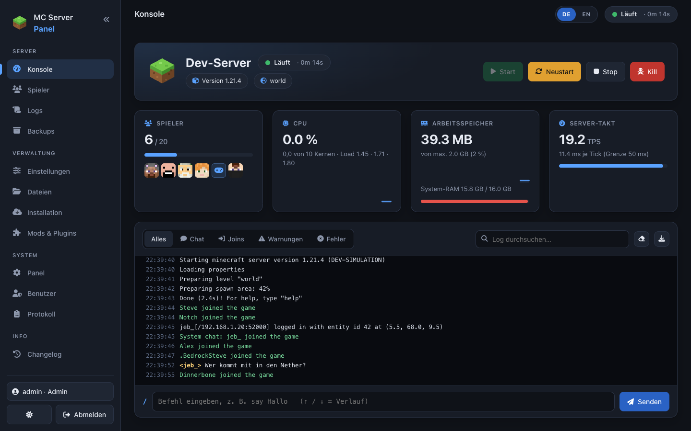
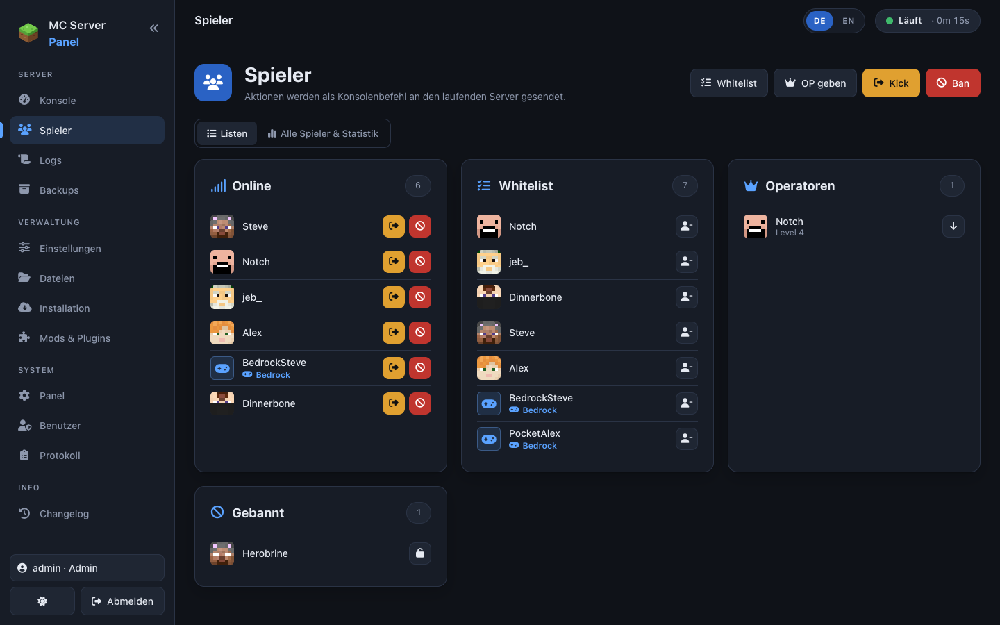
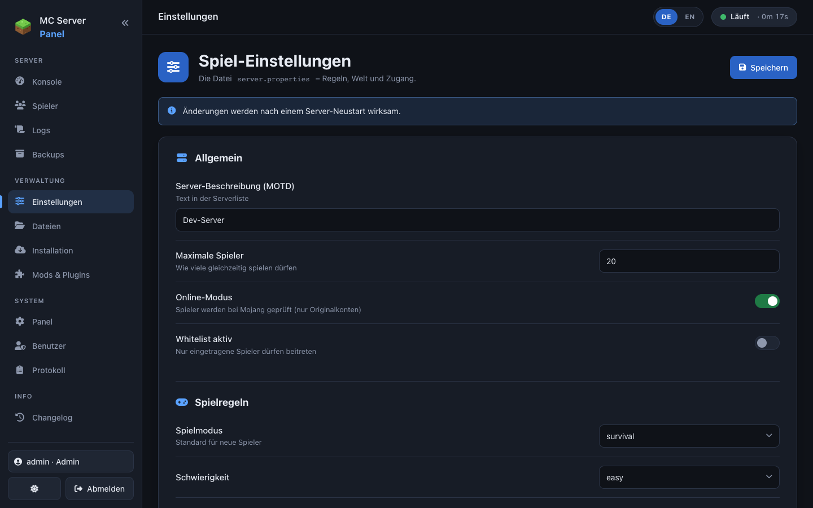
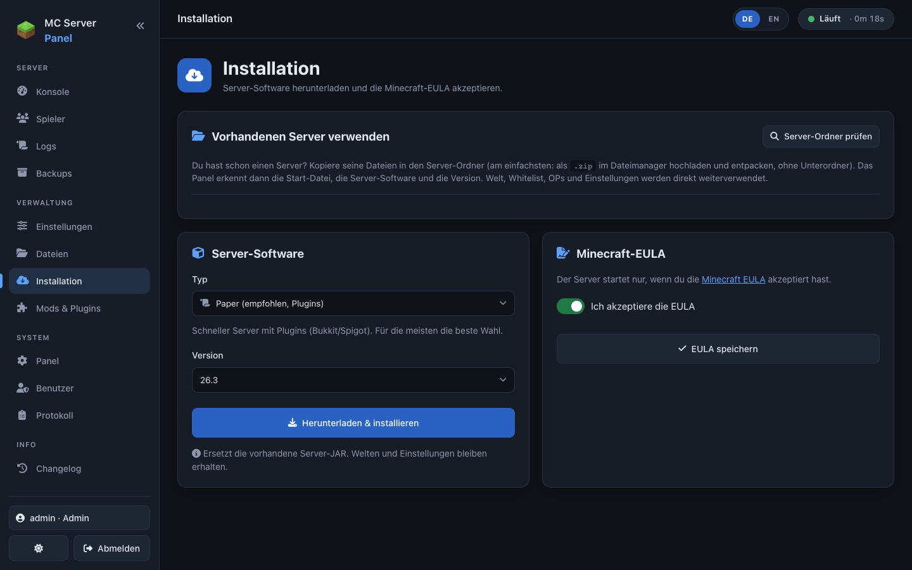
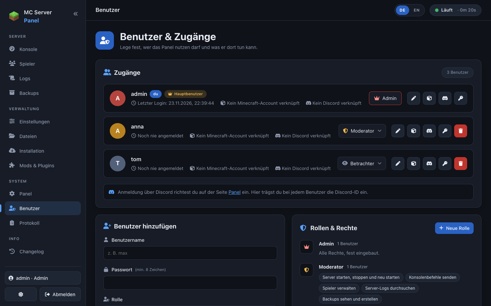

# MC Server Panel

**Deutsch** · [English](README.md)

Ein selbst gehostetes Web-Panel, mit dem du einen Minecraft-Java-Server im Browser verwaltest: starten und stoppen, Live-Konsole, Einstellungen, Dateien, Spieler, Backups, Mods und Plugins. Gedacht für einen Linux-Server, ohne Datenbank und ohne Build-Schritt.


<p align="center">
  
</p>

## Inhalt

- [Highlights](#highlights)
- [Screenshots](#screenshots)
- [Schnellstart zum Ausprobieren](#schnellstart-zum-ausprobieren)
- [Auf einem Server installieren](#auf-einem-server-installieren)
- [Bedienung und Seiten](#bedienung-und-seiten)
- [Benutzer, Rollen und Discord-Login](#benutzer-rollen-und-discord-login)
- [Konfiguration](#konfiguration)
- [Sicherheit](#sicherheit)
- [Datenschutz und externe Dienste](#datenschutz-und-externe-dienste)
- [Entwicklung](#entwicklung)
- [Mitmachen](#mitmachen)
- [Lizenz und Danksagung](#lizenz-und-danksagung)

## Highlights

- **Dashboard:** Status mit Servername, Version und Welt, Spielerzahl mit Köpfen, **TPS und MSPT** (Takt des Servers), CPU- und RAM-Verlaufskurven, Live-Konsole mit Filter (Chat, Joins, Warnungen, Fehler) und Suche, Befehle senden. Die Spielerliste wird regelmäßig mit dem Server abgeglichen, damit niemand fehlt, auch wenn eine Join-Zeile anders aussieht.
- **Server-Software per Klick:** Paper, Purpur, Folia, Fabric, Forge, NeoForge oder Vanilla, jeweils in jeder Release-Version.
- **Einstellungen:** `server.properties` als übersichtliche Liste mit Schaltern und Erklärungen.
- **Mods und Plugins:** bei [Modrinth](https://modrinth.com) suchen und mit einem Klick installieren, samt benötigter Abhängigkeiten, mit Prüfsummenkontrolle und Update-Prüfung. Es werden nur Dateien gezeigt, die zu deiner Server-Software und Minecraft-Version passen.
- **Dateimanager** mit Texteditor, Upload mit Fortschrittsanzeige und Drag & Drop, Mehrfachauswahl (löschen, als `.tar.gz` herunterladen), Entpacken von `.zip`- und `.tar.gz`-Archiven und Filter.
- **Spielerverwaltung:** Whitelist, OP, Kick, Ban. Namen werden bei Mojang geprüft, Bedrock-Spieler (Geyser/Floodgate) werden erkannt.
- **Spielerstatistik, auch rückwirkend:** Spielzeit, Tode und Mob-Kills aus den Statistikdateien der Welt, dazu Zuletzt gesehen, erster Besuch, Beitritte und **Ban-Verlauf** mit Begründung aus Logs und Panel-Protokoll. Alles lässt sich sortieren und durchsuchen, ein Klick öffnet die Details.
- **Vorhandenen Server einbinden:** Das Panel erkennt in einem vorhandenen Serverordner die Start-Datei, die Server-Software (Paper, Purpur, Fabric, Forge, NeoForge …) und die Minecraft-Version und übernimmt sie mit einem Klick.
- **Backups:** manuell, zu festen Uhrzeiten oder im Intervall, mit einstellbaren Ausschlüssen (zum Beispiel `logs`), Aufbewahrung und Download. Beim Wiederherstellen wählst du **alles** oder nur **einzelne Ordner und Dateien** aus dem Backup. Vor dem Sichern wird der freie Speicherplatz geprüft, danach das Archiv auf Fehler. Auf Wunsch kopiert das Panel jedes Backup zusätzlich in einen **anderen Ordner** (zum Beispiel ein NAS) oder per SSH auf einen **anderen Rechner**.
- **Automatik:** Neustart nach Absturz, geplanter täglicher Neustart mit Chat-Warnung, Backup-Zeitplan.
- **Benutzer, Rollen und Rechte** (feste Rollen und eigene Rollen mit frei gewählten Rechten), Discord-Login, Minecraft-Avatar, **Protokoll** aller Aktionen.
- **Logs durchsuchen:** alle Logdateien des Servers (auch gepackte `.log.gz` und Absturzberichte) an einer Stelle, mit Textsuche und Filtern nach Spieler, Art (Chat, Joins, Befehle), Ebene und Datum.
- **Mein Konto:** Minecraft-Account und Discord-ID verknüpfen, persönlich wählen, worüber man informiert wird (Hinweis im Panel, Browser-Mitteilung, **Direktnachricht per Discord-Bot**), „Überall abmelden“.
- **Zwei-Faktor-Anmeldung** (TOTP mit Authenticator-App und Wiederherstellungscodes) für jedes Konto.
- **Discord-Benachrichtigungen** per Webhook: Server online, gestoppt, abgestürzt, Backup fertig oder fehlgeschlagen, Server ruckelt, Spieler kommen und gehen.
- **Deutsch und Englisch**, umschaltbar oben rechts.
- **Oberfläche:** helles und dunkles Design, einklappbares Seitenmenü, mobil nutzbar, keine externen Schriften oder Skripte.
- **Installation:** Docker-Image mit Compose-Datei oder ein Skript, das alles als systemd-Dienst einrichtet.
- **Leichtgewichtig:** Node.js mit Express, reines JavaScript im Browser, keine Datenbank, keine Telemetrie.

## Screenshots

| | |
|---|---|
|  |  |
|  |  |

## Schnellstart zum Ausprobieren

Zum Testen brauchst du weder Java noch einen echten Minecraft-Server. Der Dev-Modus startet das Panel mit einem **simulierten** Server samt Test-Spielern.

```bash
git clone https://github.com/dev-sasa/mc-server-panel.git
cd mc-server-panel
npm install
npm run dev
```

Öffne `http://127.0.0.1:8080` und melde dich mit **admin / dev** an. Alle Daten liegen getrennt im Ordner `.dev/`.

## Auf einem Server installieren

Die komplette Anleitung (Hochladen, systemd-Dienst, HTTPS mit Caddy oder nginx, Firewall, Aktualisieren, Problemlösung) steht in **[INSTALLATION.de.md](INSTALLATION.de.md)**.

**Mit dem Installationsskript** (Linux mit systemd, Node.js 18+ ist vorausgesetzt):

```bash
sudo bash install.sh
```

Es legt einen eigenen Benutzer an, kopiert das Panel nach `/opt/mcpanel`, installiert die Abhängigkeiten, richtet den Dienst ein und zeigt dir das Startpasswort. Mit `PANEL_HOST=0.0.0.0 sudo -E bash install.sh` ist das Panel von außen erreichbar (Standard: nur lokal, siehe [INSTALLATION.de.md](INSTALLATION.de.md)).

**Mit Docker** (Panel und Java in einem Image, alle Daten im Volume `/data`):

```bash
docker compose up -d --build
docker compose logs panel      # zeigt das Startpasswort für "admin"
```

**Von Hand** auf einem Server mit Node.js 18+ und Java:

```bash
npm install --omit=dev
npm start
```

Beim ersten Start legt das Panel den Benutzer `admin` mit einem **zufälligen Passwort** an und gibt es einmal in der Konsole aus. Danach im Browser `http://SERVER-IP:8080` öffnen, unter **Installation** eine Server-Software wählen, die EULA akzeptieren und in der **Konsole** auf Start klicken.

Voraussetzungen: Node.js ≥ 18, Java 21 (für Minecraft ab 1.20.5, sonst 17) und `tar`. Optional: `unzip` (ZIP-Dateien entpacken), `rsync` und `ssh` (Backup-Kopie auf einen anderen Rechner).

## Bedienung und Seiten

Jeder Menüpunkt hat eine eigene Adresse, die du als Lesezeichen speichern kannst.

| Adresse | Inhalt | Mindestens |
|---|---|---|
| `/konsole` | Dashboard, Live-Log, Befehle, Start/Stop | Betrachter (Steuern: Moderator) |
| `/spieler` | Online-Liste, Whitelist, OPs, Bans, Statistik und Ban-Verlauf aller Spieler | Betrachter (Aktionen: Moderator) |
| `/backups` | Backups erstellen, laden, wiederherstellen | Moderator |
| `/logs` | alle Logdateien durchsuchen und filtern (Text, Spieler, Art, Ebene, Datum) | Moderator (Recht „Server-Logs durchsuchen“) |
| `/konto` | eigenes Profil, Minecraft-Account und Discord-ID, persönliche Benachrichtigungen, Passwort, 2FA, Abmelden | jeder |
| `/einstellungen` | `server.properties` | Admin |
| `/dateien` | Dateimanager und Editor | Admin |
| `/installation` | Server-Software, vorhandenen Server einbinden, EULA | Admin |
| `/mods` | Mods und Plugins suchen, installieren, aktualisieren | Admin (Recht „Server-Software installieren“) |
| `/panel` | RAM, Java, Automatik, Neustart-Zeiten, Backup-Einstellungen, Discord-Benachrichtigungen, Discord-Login, Port | Admin |
| `/benutzer` | Benutzer, Rollen, Discord-IDs | Admin |
| `/protokoll` | Wer hat wann was getan | Admin |

### Einen vorhandenen Server mitbringen

Du musst nichts importieren: Das Panel arbeitet direkt mit den Dateien im Serverordner. Kopiere deinen Server hinein (am einfachsten als `.zip` im Dateimanager hochladen und entpacken, ohne Unterordner) und klicke unter *Installation* auf **Server-Ordner prüfen**. Das Panel schlägt Start-Datei, Software und Version vor, du übernimmst oder änderst sie. Welt, Whitelist, OPs, Bans und `server.properties` werden sofort weiterverwendet. Das alte Startskript wird nicht gelesen: RAM und Java-Argumente stellst du unter *Panel → Start-Optionen* ein. Läuft der Server noch außerhalb des Panels, beende ihn vor dem ersten Start, denn das Panel kann einen laufenden Prozess nicht übernehmen.

**Welche Spielerdaten rückwirkend erscheinen:** Spielzeit, Tode und Mob-Kills (aus `world/stats`), erster und letzter Besuch sowie Beitritte (aus Logs und `playerdata`, soweit sie noch vorhanden sind) und aktuelle Bans mit Begründung. Frühere Bans und Entbannungen erscheinen nur, wenn sie noch in einem Log stehen. Ab dem Start des Panels merkt es sich Besuche dauerhaft.

## Benutzer, Rollen und Discord-Login

Was jemand darf, hängt an seiner **Rolle**. Es gibt drei feste Rollen und beliebig viele eigene:

| Rolle | Darf |
|---|---|
| **Admin** | alles |
| **Moderator** | Server starten und stoppen, Konsolenbefehle, Spieler verwalten, Logs durchsuchen, Backups sehen und erstellen |
| **Betrachter** | nur ansehen |
| **Eigene Rollen** | genau die Rechte, die du ihnen gibst |

Status, Konsolen-Log und Spielerlisten darf jeder angemeldete Benutzer ansehen. Alles Weitere ist ein einzelnes Recht, das du einer eigenen Rolle auf der Seite *Benutzer → Rollen & Rechte* zuteilst:

| Recht | Erlaubt |
|---|---|
| Server starten, stoppen und neu starten | Start, Stop, Neustart, Kill |
| Server-Logs durchsuchen | Logseite (enthält auch Chat und Befehle der Spieler) |
| Konsolenbefehle senden | Befehle in der Konsole |
| Spieler verwalten | Whitelist, OP, Kick, Ban |
| Backups sehen und erstellen | Backup-Seite, neue Backups |
| Backups herunterladen, löschen, wiederherstellen | die mächtigen Backup-Aktionen |
| Dateimanager | Dateien ansehen, bearbeiten, hochladen, löschen |
| Spiel-Einstellungen ändern | `server.properties` |
| Server-Software installieren | Installation und EULA |
| Panel-Einstellungen ändern | RAM, Java, Zeitpläne, Discord-Login |
| Benutzer verwalten | Benutzer anlegen und bearbeiten (siehe unten) |
| Protokoll ansehen | wer hat wann was getan |

Die Rechte werden im Server geprüft, nicht nur in der Oberfläche. Eigene Rollen anlegen, ändern und löschen dürfen nur **Admins**. Wer „Benutzer verwalten“ darf, aber kein Admin ist, kann nur Rollen vergeben und Benutzer bearbeiten, deren Rechte er **selbst** hat. So kann sich niemand über eine Rolle mehr Rechte verschaffen. Eine Rolle lässt sich erst löschen, wenn kein Benutzer sie mehr hat. Der **Hauptbenutzer** (der erste Benutzer) ist geschützt: Nur er selbst kann sein Konto bearbeiten, und er lässt sich nicht löschen.

**Discord-Login (optional):** Im [Discord Developer Portal](https://discord.com/developers/applications) eine Application anlegen, die im Panel unter *Panel → Discord-Login* angezeigte Redirect-URI eintragen (zeichengenau, zum Beispiel `https://panel.example.org/auth/discord/callback`) und Client-ID und -Secret speichern. Angemeldet wird, wer bei einem Benutzer die passende Discord-ID hinterlegt hat. Außer bei `localhost` verlangt Discord HTTPS.

## Konfiguration

Einstellungen nimmst du im Panel vor (Seite *Panel*). Zusätzlich liest das Panel beim Start eine optionale `.env` (Vorlage: [`.env.example`](.env.example)). Echte Umgebungsvariablen haben Vorrang.

| Variable | Bedeutung | Standard |
|---|---|---|
| `MCPANEL_HOST` | Adresse, an der das Panel lauscht (`127.0.0.1` = nur lokal) | `0.0.0.0` |
| `MCPANEL_PORT` | Port des Panels | `8080` |
| `MCPANEL_PASSWORD` | Passwort für `admin` beim allerersten Start | zufällig |
| `MCPANEL_DATA` | Ordner für `config.json`, Protokoll, `server/` und `backups/` | Programmordner (Docker: `/data`) |
| `MCPANEL_TRUST_PROXY` | Hinter einem Reverse-Proxy: `loopback`, Anzahl der Proxys (`1`), eine IP oder ein Netz, oder `false` | `loopback` |
| `MCPANEL_COOKIE_SECURE` | `1` = Cookie immer mit `Secure`, `0` = nie; sonst automatisch bei HTTPS | automatisch |
| `DISCORD_WEBHOOK_URL`, `DISCORD_WEBHOOK_ENABLED` | Webhook für Benachrichtigungen fest vorgeben | im Panel einstellbar |
| `DISCORD_BOT_TOKEN` | Bot-Token für Direktnachrichten fest vorgeben | im Panel einstellbar |
| `MCPANEL_DEV` | Dev-Modus mit simuliertem Server (`1`) | aus |
| `DISCORD_CLIENT_ID`, `DISCORD_CLIENT_SECRET`, `DISCORD_REDIRECT_URI` | Discord-Login fest vorgeben | im Panel einstellbar |

Gespeichert wird in diesen Dateien (alle in `.gitignore`):

| Pfad | Inhalt |
|---|---|
| `config.json` | Einstellungen, Benutzer (Passwörter nur als Hash, 2FA-Schlüssel), Discord-Zugang, Webhook und Bot-Token |
| `mods.json` | welche Mods und Plugins über das Panel installiert wurden |
| `playerlog.json` | erster und letzter Besuch und Beitritte je Spieler (bleibt auch nach dem Löschen alter Logs) |
| `audit.jsonl` | Protokoll (ohne IP-Adressen, wird bei 5 MB rotiert) |
| `server/` | der Minecraft-Server mit Welt |
| `backups/` | Backups |

## Sicherheit

Das Panel kann Dateien ändern und Befehle auf dem Server ausführen. Behandle es wie einen Fernzugriff:

- **Nicht ungeschützt ins Internet stellen.** Nutze einen Reverse-Proxy mit HTTPS oder einen SSH-Tunnel (`ssh -L 8080:localhost:8080 user@server`).
- Nicht als `root` betreiben, sondern mit einem eigenen Benutzer (siehe [INSTALLATION.de.md](INSTALLATION.de.md)).
- Starke Passwörter vergeben und die **Zwei-Faktor-Anmeldung** einschalten (*Mein Konto*). Nach fünf falschen Versuchen wird die Adresse eine Minute gesperrt; hinter einem Reverse-Proxy zählt dafür die echte Adresse des Besuchers (siehe `MCPANEL_TRUST_PROXY`).
- Passwörter liegen nur als `scrypt`-Hash vor. Sitzungen laufen über `HttpOnly`-Cookies, bei HTTPS zusätzlich mit `Secure`.
- Der Schlüssel der Zwei-Faktor-Anmeldung liegt (wie jedes Geheimnis, das das Panel zum Prüfen braucht) im Klartext in `config.json`, die nur der Dienstbenutzer lesen darf (Modus `600`). Wiederherstellungscodes werden nur als Hash gespeichert. Wer den Zugang zu `config.json` hat, hat damit auch den zweiten Faktor: schütze Server und Backups entsprechend.
- Die **Anmeldung per Discord** gilt als vertrauenswürdig und fragt keinen zweiten Faktor ab, weil Discord selbst schützen kann (zum Beispiel mit eigener 2FA).
- Die Webhook-Adresse für Benachrichtigungen wird nach dem Speichern nie wieder angezeigt.

Schwachstellen bitte nicht öffentlich als Issue melden, sondern wie in **[SECURITY.md](SECURITY.md)** beschrieben.

## Datenschutz und externe Dienste

Das Panel sendet keine Telemetrie und lädt keine Skripte oder Schriften von Dritten (Font Awesome liegt lokal). Für einzelne Funktionen werden diese Dienste angefragt:

| Dienst | Wofür | Wer fragt an |
|---|---|---|
| `mc-heads.net` | Spielerköpfe (Avatare) | Browser |
| `api.minecraftservices.com` | Prüfung, ob ein Java-Spielername existiert | Panel-Server |
| `api.geysermc.org` | Prüfung eines Bedrock-Gamertags | Panel-Server |
| `fill.papermc.io`, `api.purpurmc.org`, `meta.fabricmc.net`, `maven.minecraftforge.net`, `maven.neoforged.net`, `piston-meta.mojang.com` | Versionslisten und Downloads der Server-Software, nur bei der Installation | Panel-Server |
| `discord.com` | Anmeldung, nur wenn Discord-Login aktiviert ist; Benachrichtigungen, nur wenn ein Webhook eingetragen ist | Browser und Panel-Server |
| `api.modrinth.com`, `cdn.modrinth.com` | Suche und Download von Mods und Plugins; die Symbole in der Trefferliste lädt der Browser von `cdn.modrinth.com` | Panel-Server und Browser |

Im Protokoll werden **keine IP-Adressen** gespeichert.

## Entwicklung

```bash
npm install
npm run dev      # Panel mit simuliertem Minecraft-Server, startet bei Änderungen neu
npm run check    # prüft die Syntax aller JavaScript-Dateien
npm test         # automatische Tests (Node.js ≥ 18, keine weiteren Abhängigkeiten)
```

Die Tests starten das Panel im Dev-Modus mit einem eigenen temporären Datenordner und einem freien Port und sprechen es über HTTP an. Sie prüfen Anmeldung, Rechte und Rollen, Pfad-Sicherheit, Backups, 2FA, Spielerabgleich, TPS, Webhooks, Mods und Dateimanager. Modrinth und Discord werden dabei durch kleine Attrappen ersetzt, es gehen also keine echten Anfragen ins Internet.

Projektaufbau:

```
server.js          Start: bindet die Module ein, HTTP- und WebSocket-Server
lib/               core (Konfiguration, Protokoll), minecraft (Prozess, Konsole, Spieler, TPS), auth (Sitzungen,
                   Rechte), schedule (Zeitplaner), notify (Discord-Webhook), totp, modrinth, backupUtil …
routes/            die API, nach Themen: login, session, twofa, server, users, settings, files, players,
                   install, mods, backups
public/            Oberfläche: HTML, CSS und reines JavaScript, Font Awesome lokal; i18n.js und i18n-en.js
                   für die Sprachumschaltung
dev/               fake-mc.js (simulierter Minecraft-Server) und i18n-extract.js (Übersetzungen pflegen)
test/              automatische Tests
Dockerfile, docker-compose.yml, install.sh, mcpanel.service    Betrieb
INSTALLATION.de.md Anleitung für den Linux-Server (Englisch: INSTALLATION.md)
```

**Übersetzungen:** Die Oberfläche ist auf Deutsch geschrieben, die englischen Texte stehen in `public/i18n-en.js`. `node dev/i18n-extract.js` zeigt, welche deutschen Texte noch keine Übersetzung haben. Texte ohne Eintrag bleiben deutsch. Die Benachrichtigungen an Discord sind nur auf Deutsch.

Es gibt keinen Build-Schritt: Änderungen an `public/` sind nach dem Neuladen der Seite sichtbar.

## Mitmachen

Fehler, Ideen und Pull Requests sind willkommen. Lies bitte zuerst [CONTRIBUTING.md](CONTRIBUTING.md). Änderungen stehen im [CHANGELOG.md](CHANGELOG.md).

## Lizenz und Danksagung

- Der Quellcode steht unter der [MIT-Lizenz](LICENSE).
- Icons: [Font Awesome Free](https://fontawesome.com/license/free) (Icons CC BY 4.0, Schriften SIL OFL 1.1, Code MIT). Die Lizenzdatei liegt in `public/vendor/fontawesome/`.
- Spielerköpfe: [mc-heads.net](https://mc-heads.net).
- „Minecraft“ ist eine Marke von Mojang Synergies AB. Dieses Projekt ist ein unabhängiges Werkzeug und steht in keiner Verbindung zu Mojang, Microsoft, PaperMC, Fabric, Forge, NeoForged oder Discord.
