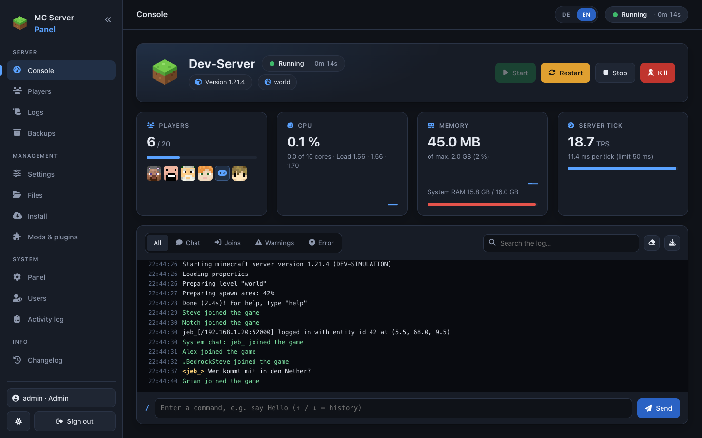
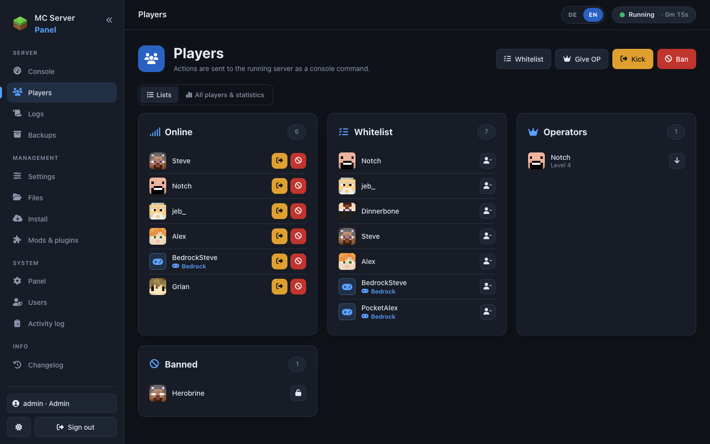
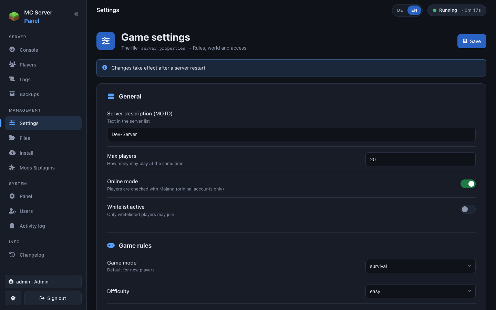
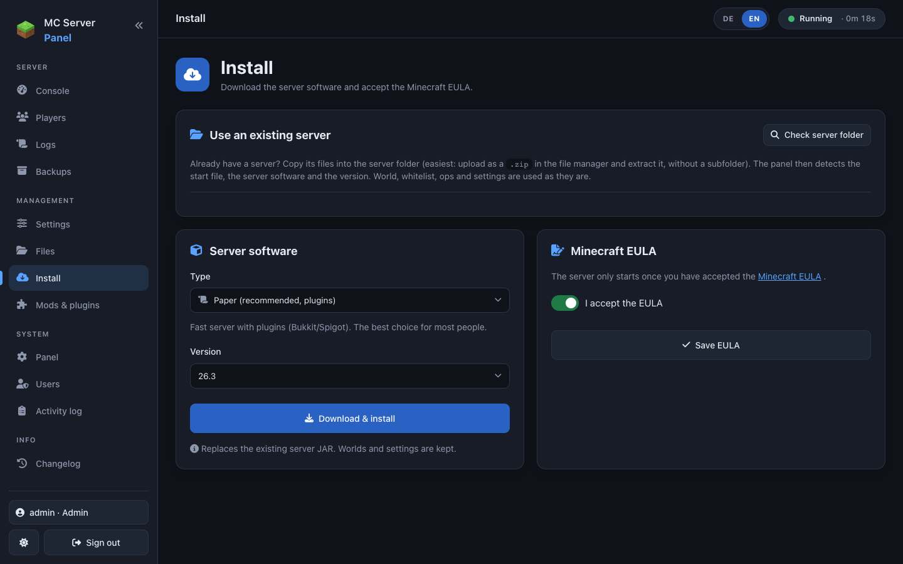
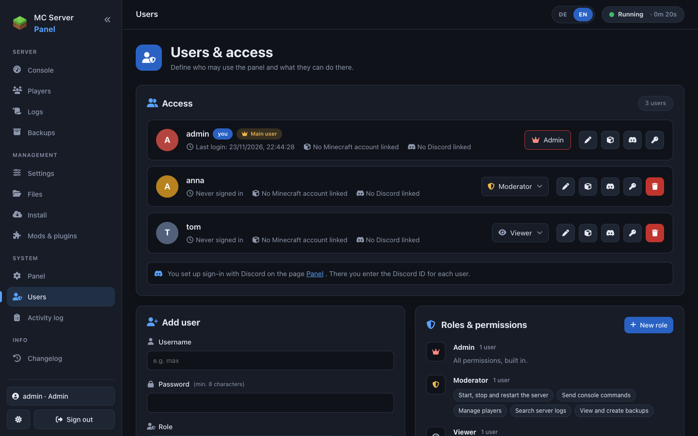

# MC Server Panel

[Deutsch](README.de.md) · **English**

A self-hosted web panel for managing a Minecraft Java server in your browser: start and stop, live console, settings, files, players, backups, mods and plugins. Built for a Linux server, with no database and no build step.


<p align="center">
  
</p>

## Contents

- [Highlights](#highlights)
- [Screenshots](#screenshots)
- [Quick start to try it out](#quick-start-to-try-it-out)
- [Installing on a server](#installing-on-a-server)
- [Usage and pages](#usage-and-pages)
- [Users, roles and Discord login](#users-roles-and-discord-login)
- [Configuration](#configuration)
- [Security](#security)
- [Privacy and external services](#privacy-and-external-services)
- [Development](#development)
- [Contributing](#contributing)
- [License and acknowledgments](#license-and-acknowledgments)

## Highlights

- **Dashboard:** status with server name, version and world, player count with heads, **TPS and MSPT** (the server's tick rate), CPU and RAM history charts, live console with filters (chat, joins, warnings, errors) and search, send commands. The player list is reconciled with the server at regular intervals so nobody is missing, even if a join line looks different.
- **Server software at a click:** Paper, Purpur, Folia, Fabric, Forge, NeoForge or Vanilla, each in every release version.
- **Settings:** `server.properties` as a clear list with switches and explanations.
- **Mods and plugins:** search on [Modrinth](https://modrinth.com) and install with one click, including required dependencies, with checksum verification and update checks. Only files that match your server software and Minecraft version are shown.
- **File manager** with text editor, upload with progress bar and drag & drop, multi-select (delete, download as `.tar.gz`), extraction of `.zip` and `.tar.gz` archives, and a filter.
- **Player management:** whitelist, OP, kick, ban. Names are checked with Mojang, and Bedrock players (Geyser/Floodgate) are recognized.
- **Player statistics, also retroactively:** playtime, deaths and mob kills from the world's statistics files, plus last seen, first visit, joins and **ban history** with reasons from logs and the activity log. Everything can be sorted and searched, and a click opens the details.
- **Bring an existing server:** in an existing server folder, the panel detects the start file, the server software (Paper, Purpur, Fabric, Forge, NeoForge …) and the Minecraft version, and adopts them with one click.
- **Backups:** manual, at fixed times or at an interval, with configurable exclusions (for example `logs`), retention and download. When restoring, you choose **everything** or only **individual folders and files** from the backup. Free disk space is checked before backing up, and the archive is checked for errors afterwards. If you like, the panel also copies every backup to **another folder** (for example a NAS) or via SSH to **another machine**.
- **Automation:** restart after a crash, scheduled daily restart with chat warning, backup schedule.
- **Users, roles and permissions** (fixed roles and custom roles with freely chosen permissions), Discord login, Minecraft avatar, **activity log** of all actions.
- **Search logs:** all log files of the server (including packed `.log.gz` files and crash reports) in one place, with text search and filters by player, type (chat, joins, commands), level and date.
- **My account:** link your Minecraft account and Discord ID, choose personally what you are notified about (notice in the panel, browser notification, **direct message via Discord bot**), "Sign out everywhere".
- **Two-factor authentication** (TOTP with an authenticator app and recovery codes) for every account.
- **Discord notifications** via webhook: server online, stopped, crashed, backup finished or failed, server lagging, players joining and leaving.
- **German and English**, switchable at the top right (the panel's interface language can be changed at any time).
- **Interface:** light and dark design, collapsible side menu, usable on mobile, no external fonts or scripts.
- **Installation:** Docker image with a Compose file, or a script that sets everything up as a systemd service.
- **Lightweight:** Node.js with Express, plain JavaScript in the browser, no database, no telemetry.

## Screenshots

| | |
|---|---|
|  |  |
|  |  |

## Quick start to try it out

To test it, you need neither Java nor a real Minecraft server. Dev mode starts the panel with a **simulated** server including test players.

```bash
git clone https://github.com/dev-sasa/mc-server-panel.git
cd mc-server-panel
npm install
npm run dev
```

Open `http://127.0.0.1:8080` and sign in with **admin / dev**. All data is kept separately in the `.dev/` folder.

## Installing on a server

The complete guide (uploading, systemd service, HTTPS with Caddy or nginx, firewall, updating, troubleshooting) is in **[INSTALLATION.md](INSTALLATION.md)**.

**With the installation script** (Linux with systemd, Node.js 18+ is required):

```bash
sudo bash install.sh
```

It creates a dedicated user, copies the panel to `/opt/mcpanel`, installs the dependencies, sets up the service and shows you the initial password. With `PANEL_HOST=0.0.0.0 sudo -E bash install.sh` the panel is reachable from outside (default: local only, see [INSTALLATION.md](INSTALLATION.md)).

**With Docker** (panel and Java in one image, all data in the `/data` volume):

```bash
docker compose up -d --build
docker compose logs panel      # shows the initial password for "admin"
```

**By hand** on a server with Node.js 18+ and Java:

```bash
npm install --omit=dev
npm start
```

On first start, the panel creates the user `admin` with a **random password** and prints it once in the console. Then open `http://SERVER-IP:8080` in your browser, choose a server software under **Install**, accept the EULA and click Start in the **Console**.

Requirements: Node.js ≥ 18, Java 21 (for Minecraft 1.20.5 and later, otherwise 17) and `tar`. Optional: `unzip` (extract ZIP files), `rsync` and `ssh` (copy backups to another machine).

## Usage and pages

Every menu item has its own address, which you can bookmark. The addresses are German; the pages are named as shown in the English interface.

| Address | Content | Minimum role |
|---|---|---|
| `/konsole` | Console: dashboard, live log, commands, start/stop | Viewer (control: Moderator) |
| `/spieler` | Players: online list, whitelist, OPs, bans, statistics and ban history of all players | Viewer (actions: Moderator) |
| `/backups` | Backups: create, download, restore | Moderator |
| `/logs` | Logs: search and filter all log files (text, player, type, level, date) | Moderator ("Search server logs" permission) |
| `/konto` | My account: own profile, Minecraft account and Discord ID, personal notifications, password, 2FA, sign out | everyone |
| `/einstellungen` | Settings: `server.properties` | Admin |
| `/dateien` | Files: file manager and editor | Admin |
| `/installation` | Install: server software, bring an existing server, EULA | Admin |
| `/mods` | Mods & plugins: search, install, update | Admin ("Install server software" permission) |
| `/panel` | Panel: RAM, Java, automation, restart times, backup settings, Discord notifications, Discord login, port | Admin |
| `/benutzer` | Users: users, roles, Discord IDs | Admin |
| `/protokoll` | Activity log: who did what and when | Admin |

### Bring an existing server

You do not need to import anything: the panel works directly with the files in the server folder. Copy your server into it (the easiest way is to upload it as a `.zip` in the file manager and extract it, without a subfolder) and click **Check server folder** under *Install*. The panel suggests the start file, software and version, and you accept or change them. World, whitelist, OPs, bans and `server.properties` are used right away. The old start script is not read: you set RAM and Java arguments under *Panel → Start options*. If the server is still running outside the panel, stop it before the first start, because the panel cannot take over a running process.

**Which player data appears retroactively:** playtime, deaths and mob kills (from `world/stats`), first and last visit and joins (from logs and `playerdata`, as far as they still exist) and current bans with reasons. Earlier bans and unbans only appear if they are still in a log. From the moment the panel starts, it remembers visits permanently.

## Users, roles and Discord login

What someone is allowed to do depends on their **role**. There are three fixed roles and any number of custom ones:

| Role | Can |
|---|---|
| **Admin** | everything |
| **Moderator** | start and stop the server, console commands, manage players, search logs, view and create backups |
| **Viewer** | view only |
| **Custom roles** | exactly the permissions you give them |

Every signed-in user may view the status, console log and player lists. Everything else is an individual permission that you assign to a custom role on the page *Users → Roles & permissions*:

| Permission | Allows |
|---|---|
| Start, stop and restart server | Start, stop, restart, kill |
| Search server logs | Logs page (also contains players' chat and commands) |
| Send console commands | Commands in the console |
| Manage players | Whitelist, OP, kick, ban |
| View and create backups | Backups page, new backups |
| Download, delete and restore backups | the powerful backup actions |
| File manager | view, edit, upload and delete files |
| Change game settings | `server.properties` |
| Install server software | Install and EULA |
| Change panel settings | RAM, Java, schedules, Discord login |
| Manage users | create and edit users (see below) |
| View activity log | who did what and when |

Permissions are enforced on the server, not just in the interface. Only **admins** may create, change and delete custom roles. Anyone who may "Manage users" but is not an admin can only assign roles and edit users whose permissions they **themselves** have. This way nobody can gain more permissions through a role. A role can only be deleted once no user has it any more. The **main user** (the first user) is protected: only they can edit their own account, and it cannot be deleted.

**Discord login (optional):** Create an application in the [Discord Developer Portal](https://discord.com/developers/applications), enter the redirect URI shown in the panel under *Panel → Discord login* (character for character, for example `https://panel.example.org/auth/discord/callback`) and save the client ID and secret. Anyone whose matching Discord ID is stored on a user can sign in. Except for `localhost`, Discord requires HTTPS.

## Configuration

You change settings in the panel (the *Panel* page). In addition, the panel reads an optional `.env` on startup (template: [`.env.example`](.env.example)). Real environment variables take precedence.

| Variable | Meaning | Default |
|---|---|---|
| `MCPANEL_HOST` | Address the panel listens on (`127.0.0.1` = local only) | `0.0.0.0` |
| `MCPANEL_PORT` | Port of the panel | `8080` |
| `MCPANEL_PASSWORD` | Password for `admin` on the very first start | random |
| `MCPANEL_DATA` | Folder for `config.json`, activity log, `server/` and `backups/` | program folder (Docker: `/data`) |
| `MCPANEL_TRUST_PROXY` | Behind a reverse proxy: `loopback`, number of proxies (`1`), an IP or a network, or `false` | `loopback` |
| `MCPANEL_COOKIE_SECURE` | `1` = cookie always with `Secure`, `0` = never; otherwise automatic with HTTPS | automatic |
| `DISCORD_WEBHOOK_URL`, `DISCORD_WEBHOOK_ENABLED` | Preset the webhook for notifications | configurable in the panel |
| `DISCORD_BOT_TOKEN` | Preset the bot token for direct messages | configurable in the panel |
| `MCPANEL_DEV` | Dev mode with simulated server (`1`) | off |
| `DISCORD_CLIENT_ID`, `DISCORD_CLIENT_SECRET`, `DISCORD_REDIRECT_URI` | Preset the Discord login | configurable in the panel |

Data is stored in these files (all in `.gitignore`):

| Path | Content |
|---|---|
| `config.json` | Settings, users (passwords only as hashes, 2FA secrets), Discord credentials, webhook and bot token |
| `mods.json` | which mods and plugins were installed through the panel |
| `playerlog.json` | first and last visit and joins per player (kept even after old logs are deleted) |
| `audit.jsonl` | Activity log (without IP addresses, rotated at 5 MB) |
| `server/` | the Minecraft server with world |
| `backups/` | Backups |

## Security

The panel can change files and run commands on the server. Treat it like remote access:

- **Do not expose it unprotected to the internet.** Use a reverse proxy with HTTPS or an SSH tunnel (`ssh -L 8080:localhost:8080 user@server`).
- Do not run it as `root`; use a dedicated user instead (see [INSTALLATION.md](INSTALLATION.md)).
- Use strong passwords and turn on **two-factor authentication** (*My account*). After five failed attempts the address is blocked for one minute; behind a reverse proxy, the visitor's real address is what counts (see `MCPANEL_TRUST_PROXY`).
- Passwords are stored only as `scrypt` hashes. Sessions use `HttpOnly` cookies, additionally with `Secure` over HTTPS.
- The two-factor secret is stored in plain text (like any secret the panel needs in order to verify something) in `config.json`, which only the service user may read (mode `600`). Recovery codes are stored only as hashes. Whoever has access to `config.json` therefore also has the second factor: protect the server and backups accordingly.
- **Signing in with Discord** is considered trustworthy and does not ask for a second factor, because Discord can protect the account itself (for example with its own 2FA).
- The webhook address for notifications is never shown again after saving.

Please do not report vulnerabilities publicly as an issue, but as described in **[SECURITY.md](SECURITY.md)**.

## Privacy and external services

The panel sends no telemetry and loads no scripts or fonts from third parties (Font Awesome is hosted locally). For individual features, these services are queried:

| Service | Purpose | Who makes the request |
|---|---|---|
| `mc-heads.net` | Player heads (avatars) | Browser |
| `api.minecraftservices.com` | Checking whether a Java player name exists | Panel server |
| `api.geysermc.org` | Checking a Bedrock gamertag | Panel server |
| `fill.papermc.io`, `api.purpurmc.org`, `meta.fabricmc.net`, `maven.minecraftforge.net`, `maven.neoforged.net`, `piston-meta.mojang.com` | Version lists and downloads of the server software, only during installation | Panel server |
| `discord.com` | Login, only if Discord login is enabled; notifications, only if a webhook is entered | Browser and panel server |
| `api.modrinth.com`, `cdn.modrinth.com` | Search and download of mods and plugins; the browser loads the icons in the result list from `cdn.modrinth.com` | Panel server and browser |

**No IP addresses** are stored in the activity log.

## Development

```bash
npm install
npm run dev      # panel with simulated Minecraft server, restarts on changes
npm run check    # checks the syntax of all JavaScript files
npm test         # automated tests (Node.js ≥ 18, no further dependencies)
```

The tests start the panel in dev mode with their own temporary data folder and a free port and talk to it over HTTP. They cover login, permissions and roles, path safety, backups, 2FA, player reconciliation, TPS, webhooks, mods and the file manager. Modrinth and Discord are replaced by small stand-ins, so no real requests go out to the internet.

Project layout:

```
server.js          Start: wires up the modules, HTTP and WebSocket server
lib/               core (configuration, activity log), minecraft (process, console, players, TPS), auth (sessions,
                   permissions), schedule (scheduler), notify (Discord webhook), totp, modrinth, backupUtil …
routes/            the API, by topic: login, session, twofa, server, users, settings, files, players,
                   install, mods, backups
public/            Interface: HTML, CSS and plain JavaScript, Font Awesome locally; i18n.js and i18n-en.js
                   for the language switch
dev/               fake-mc.js (simulated Minecraft server) and i18n-extract.js (maintaining translations)
test/              automated tests
Dockerfile, docker-compose.yml, install.sh, mcpanel.service    Operation
INSTALLATION.md    Guide for the Linux server (German: INSTALLATION.de.md)
```

**Translations:** The interface is written in German, and the English texts live in `public/i18n-en.js`. `node dev/i18n-extract.js` shows which German texts do not have a translation yet. Texts without an entry stay German. The notifications sent to Discord are in German only.

There is no build step: changes to `public/` are visible after reloading the page.

## Contributing

Bugs, ideas and pull requests are welcome. Please read [CONTRIBUTING.md](CONTRIBUTING.md) first (German only). Changes are listed in the [CHANGELOG.md](CHANGELOG.md).

## License and acknowledgments

- The source code is under the [MIT License](LICENSE).
- Icons: [Font Awesome Free](https://fontawesome.com/license/free) (icons CC BY 4.0, fonts SIL OFL 1.1, code MIT). The license file is in `public/vendor/fontawesome/`.
- Player heads: [mc-heads.net](https://mc-heads.net).
- "Minecraft" is a trademark of Mojang Synergies AB. This project is an independent tool and is not affiliated with Mojang, Microsoft, PaperMC, Fabric, Forge, NeoForged or Discord.
